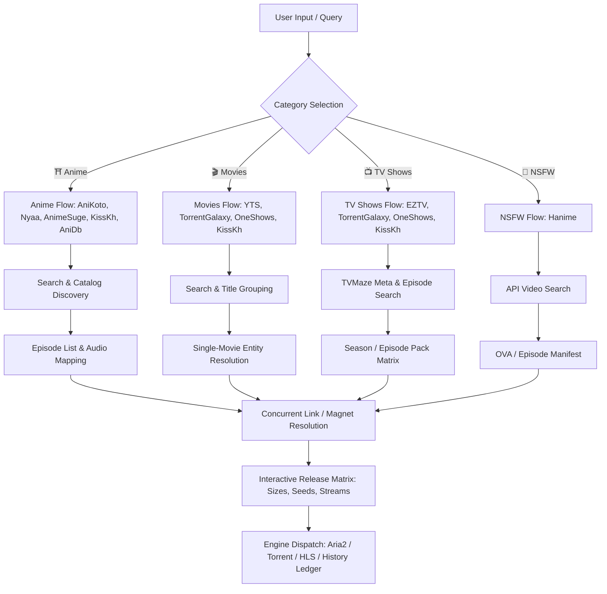
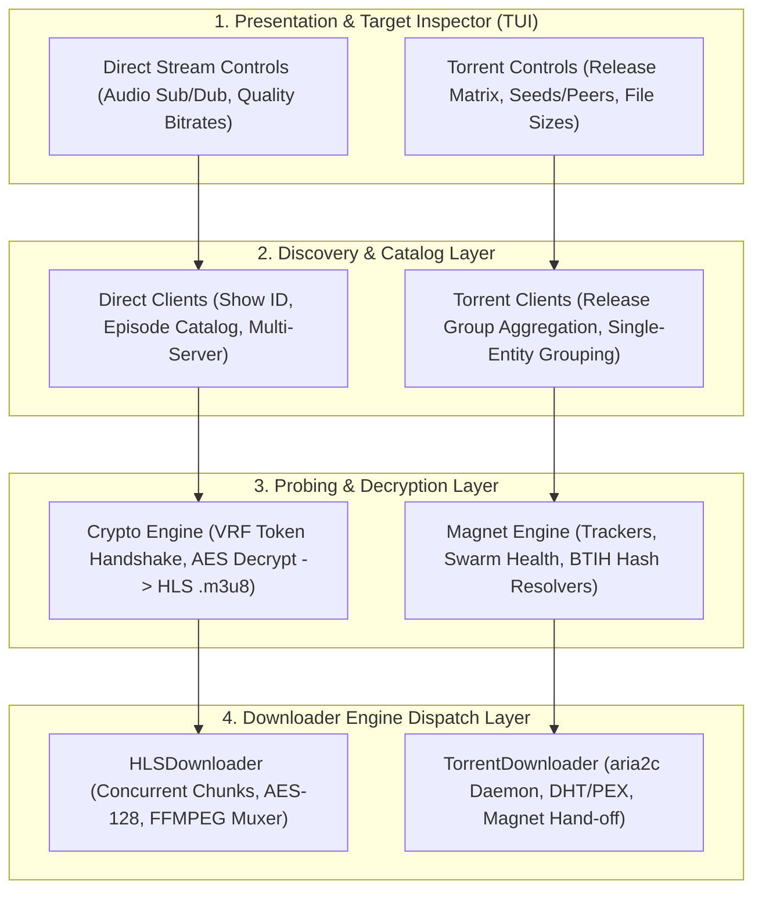

# System Architecture & Next-Gen Terminal UI Design (Design.md)

> **CLI Media Scraper & Downloader**  
> *A Modern, Fluid, Keyboard-Native Media Aggregator & Terminal Dashboard*

---

## 1. 🌌 Design Philosophy & TUI Benchmarks

Modern terminal applications ([Awesome TUI](https://awesometui.com/), *LazyGit*, *btop*, *k9s*, *Yazi*, *Superfile*) have abandoned rigid nested boxes, heavy borders, and clunky web-like form controls in favor of **fluid, typography-first, keyboard-native workflows**.

```
┌──────────────────────────────────────────────────────────────────────────────────────────────────────────────────┐
│  OLD BOXY PARADIGM                                     NEXT-GEN FLUID PARADIGM                                   │
├──────────────────────────────────────────────────────────────────────────────────────────────────────────────────┤
│  ❌ Clunky nested rounded boxes inside split panes       │  ✔ Borderless subtle surfaces with tonal depth (#0d1117/#161b22)│
│  ❌ Rigid 60%/40% hard split leaving dead whitespace     │  ✔ Responsive flex layout with collapsible detail drawer      │
│  ❌ Standard HTML-style dropdown selects                │  ✔ Interactive Release Matrix table with live seed/size bars  │
│  ❌ Unresponsive tab-switching and blocking prompts     │  ✔ Async non-blocking workers with micro-status indicators    │
│  ❌ Generic error toasts                                 │  ✔ Context-aware diagnostics and actionable recovery paths    │
└──────────────────────────────────────────────────────────────────────────────────────────────────────────────────┘
```

### Aesthetic & Token System

```
  Background  : #0b0f19 (Obsidian Deep)
  Surface Base: #121826 (Slate Dark)
  Surface High: #1b2336 (Slate Highlight)
  Border Subtle: #232d42 (Hairline Guide)
  Text Primary: #f0f6fc (High-Contrast White)
  Text Muted  : #8b949e (Cool Gray)
  
  Accents:
    ⛩️  Anime  : #c084fc (Amethyst Neon)
    🎬  Movie  : #38bdf8 (Sky Cyan)
    📺  TV     : #34d399 (Emerald Green)
    🔞  NSFW   : #fb7185 (Rose Crimson)
    ⚡  Action : #f59e0b (Amber Glow)
```

---

## 2. 🔄 Step-by-Step Provider Data Lifecycles

Every content category and provider operates with distinct data structures, authentication/decryption requirements, and link resolution mechanics. Below is the complete step-by-step lifecycle for all 10 integrated providers.



---

### Category 1: ⛩️ Anime

#### 1.1 AniKoto (`AnikotoClient`) — *Rank #1 Top Pick (HLS Direct Stream)*
* **Architecture**: Direct REST API + Reverse-Engineered RC4/ROT13 VRF Signature + AES-256-CBC Payload Decryption.
* **Step-by-Step Flow**:
  1. **Search**: `GET https://anikoto.cz/api/anime/search?q={query}`
     * *Returns*: `[{id, title, japanese_title, poster, episodes_count, sub_count, dub_count, format, score}]`
  2. **Episode Catalog**: `GET https://anikoto.cz/api/anime/{id}/episodes`
     * *Returns*: `[{id, number, title, sub, dub, data_id}]`
  3. **Player Session**: `GET /api/player/v/{data_id}` with dynamic VRF token header.
  4. **Source Decryption**: Unpacks AES-256-CBC encrypted video source into master `.m3u8` URL + WebVTT subtitle track links.
  5. **Resolution Discovery**: Probes master manifest for `1080p`, `720p`, `480p`, `360p` bitrate streams.

#### 1.2 Nyaa (`NyaaClient`) — *Anime Torrents*
* **Architecture**: HTML & RSS Scrape with Regex Filter & Health Scoring.
* **Step-by-Step Flow**:
  1. **Search**: `GET https://nyaa.si/?f=0&c=1_2&q={query} {audio_tag}`
  2. **Release Extraction**: Parses raw release rows: info_hash, magnet URI, seeds, leechers, file size, release group (e.g. *SubsPlease*, *Erai-raws*, *Judas*).
  3. **Audio Scoring**: Prioritizes `Dual Audio` / `English Dub` when audio preference is set to `dub` or `dual`.

#### 1.3 AnimeSuge (`AnimeSugeClient`) — *Multi-Server Streams*
* **Architecture**: VRF Search Tokens + AJAX Server List + Embed Decryption.
* **Step-by-Step Flow**:
  1. **Search**: Resolves show ID with anti-bot challenge headers.
  2. **Server Discovery**: Fetches available servers (*MegaCloud*, *Vidstream*) for Sub and Dub tracks.
  3. **Stream Resolution**: Decrypts embed iframe source to direct HLS m3u8.

#### 1.4 KissKh (`KissKhClient`) — *Asian Drama & Anime*
* **Architecture**: REST API endpoint + Episode ID mapping + Direct CDN HLS streams.

---

### Category 2: 🎬 Movies

#### 2.1 YTS / YIFY (`YTSClient`) — *Movie Torrents*
* **Architecture**: Official YTS JSON API v2.
* **Step-by-Step Flow**:
  1. **Search**: `GET https://yts.mx/api/v2/list_movies.json?query_term={query}&sort_by=seeds`
     * *Returns*: `[{id, title, year, rating, runtime, genres, synopsis, torrents: [...]}]`
  2. **Release Aggregation**:
     * Parses `torrents` array into discrete releases:
       * `2160p (4K UHD) • 6.64 GB • Seeds: 100 • Bluray`
       * `1080p (FHD) • 1.85 GB • Seeds: 100 • Bluray`
       * `720p (HD) • 1.07 GB • Seeds: 76 • Bluray`
  3. **Magnet Generation**: Builds magnet URI with 15 high-speed public trackers (`open.demonii`, `opentrackr`, `tracker.openbittorrent`).
  4. **No Episode Input**: Episode range prompt is completely bypassed (Single Movie).

#### 2.2 TorrentGalaxy (`TGxClient`) — *Movies Torrents*
* **Architecture**: HTML Mirror Scraping + Title Grouping + Parallel Magnet Extraction.
* **Step-by-Step Flow**:
  1. **Search**: Queries active mirror (`torrentgalaxy.one`, `tgx.rs`) -> returns 10-40 raw scene releases.
  2. **Single-Movie Grouping**: Regex clean cleans titles (strips resolution, codecs, release tags) and groups all releases under `Inception (2010)` displaying total releases count and top seeds.
  3. **Parallel Release Probing**: `ThreadPoolExecutor` fetches detail pages in parallel, resolving magnets, exact file sizes (`5.7 GB`, `11.1 GB`, `2.0 GB`), seeds, peers, and release tags (`WEB-DL`, `x265`, `Remux`).
  4. **Direct Download**: Passes selected release magnet directly to torrent downloader.

#### 2.3 OneShows (`OneShowsClient`) — *Direct Movie Streams*
* **Architecture**: TMDB Metadata + Embed Provider Resolution -> Direct HLS.

---

### Category 3: 📺 TV Shows

#### 3.1 EZTV (`EZTVClient`) — *TV Torrents*
* **Architecture**: EZTV API + IMDb ID lookup + Episode Regex Mapping.
* **Step-by-Step Flow**:
  1. **Search**: Resolves IMDb ID -> `GET https://eztvx.to/api/get-torrents?imdb_id={imdb_id}`
  2. **Episode Tree**: Maps releases into Season & Episode keys (`S01E01`, `S01E02`...).
  3. **Release Selection**: Gathers 1080p, 720p, HDTV torrents per episode.

#### 3.2 TorrentGalaxy (`TGxClient`) — *TV Shows*
* **Architecture**: TVMaze Catalog Integration + Multi-Pattern Episode & Season Pack Matching.
* **Step-by-Step Flow**:
  1. **Metadata Query**: `GET https://api.tvmaze.com/search/shows?q={query}` -> show rating, premiered year, genres, total episodes.
  2. **Episode Fetch**: `GET https://api.tvmaze.com/shows/{id}/episodes` -> S01E01 to S01EN.
  3. **TGx Query Matching**: Matches single episode (`S01E01`), range pack (`S01E01-08`), or season pack (`Season 1` / `S01`).

---

### Category 4: 🔞 NSFW / Hentai

#### 4.1 Hanime (`HanimeClient`)
* **Architecture**: Hanime JSON API v8.
* **Step-by-Step Flow**:
  1. **Search**: `POST https://hanime.tv/api/v8/video` with search payload -> video title, brand, views, tags, censor status.
  2. **Manifest Discovery**: Extracts multi-resolution HLS streams (`1080p`, `720p`, `480p`, `360p`).

---

## 3. 🧩 Separation of Concerns: Torrents vs. Direct Streams

To avoid tight coupling and leaking protocol-specific logic across the application, the architecture enforces a strict **4-Layer Separation of Concerns**:



### Architectural Separation Matrix

| Architectural Layer | 🌊 Direct Streams (HLS / CDN) | ⚡ Torrents (P2P / BitTorrent) |
| :--- | :--- | :--- |
| **1. Data Model & Catalog** | **Canonical Entity**: Show ID, Episode counts, Sub/Dub availability, CDN Server IDs (*MegaCloud*, *Vidstream*). | **Scene Releases**: Multi-Release groupings, Release Group tags (*SubsPlease*, *GalaxyRG*, *YTS*), info_hashes. |
| **2. Probing & Payload** | **Crypto Handshake**: VRF tokens (RC4/ROT13) + AES-256-CBC payload decrypt -> `.m3u8` master playlist + WebVTT subtitles. | **Swarm Probing**: `magnet:?xt=urn:btih:...` with public trackers, seeders/leechers count, exact file sizes in MB/GB. |
| **3. UI / Inspector Controls** | • Audio Language selector (`Sub`, `Dub`, `Dual Audio`)<br>• Dynamic Episode range input (`1-12`, `all`)<br>• Resolution dropdown (`1080p`, `720p`, `480p`) | • Interactive **Release Matrix** (Seeds bar, Health meter, Sizes)<br>• Auto-bypassed episode selector for single movies<br>• Magnet & Hash inspection |
| **4. Downloader Engine** | **`HLSDownloader`**: Concurrent chunk worker pool (`.ts`/`.m4s`), AES-128 segment decryption, and `ffmpeg` MKV container remuxing. | **`TorrentDownloader`**: Background `aria2c` process with peer exchange/DHT or native desktop client dispatch (`xdg-open`). |
| **5. Error Recovery** | Automatic CDN server failover (*MegaCloud* -> *Vidstream*) & segment chunk retries with exponential backoff. | Fallback mirror cycling (`torrentgalaxy.to` -> `tgx.rs`) and backup tracker injection. |

---

## 4. 🖥️ Data Requirements Matrix by Content Type

| Content Type | Episode Range Needed? | Audio Selector? | Release Matrix Display | Downloader Engine |
| :--- | :--- | :--- | :--- | :--- |
| **⛩️ Anime** | Yes (`1-12`, `all`, `1,3,5`) | Yes (`Sub`, `Dub`, `Dual`) | Bitrates (`1080p`, `720p`, `480p`) + Torrent Seeds | HLS Stream / Torrent |
| **🎬 Movies** | **No** (Auto `1/1 Full Film`) | Optional (Dual Audio) | Multi-Release Torrents (Size, Seeds, Format, Group) | Torrent / HLS Stream |
| **📺 TV Shows** | Yes (`S01E01-E10`, `1-12`) | Optional | Season/Episode Torrents + Streams | Torrent / HLS Stream |
| **🔞 NSFW** | Yes (`1-2`, `all`) | No | Bitrates (`1080p`, `720p`, `480p`) | HLS Stream |

---

## 5. 🎨 Next-Gen TUI Visual Architecture (ASCII Wireframes)

### Main Search & Browse Interface (Fluid Borderless Split)

```
╭─ 🎬 MEDIA SCRAPER & DOWNLOADER ───────────────────────────────────────────────────────────── v1.8.0 ─ [14:45] ─╮
│  [1] 🔍 Search & Browse     [2] ⚡ Activity (2)     [3] 📜 History     [4] ⚙ Settings                          │
├─────────────────────────────────────────────────────────────────────────────────────────────────────────────────┤
│  CATEGORY: [ ⛩️ Anime ▾ ]    PROVIDER: [ 🔥 AniKoto ▾ ]    SEARCH: [ Solo Leveling                   ] [ 🔍 Run ]│
├──────────────────────────────────────────────────────────────────┬──────────────────────────────────────────────┤
│  MATCHES (12)                                                   │  TARGET INSPECTOR                            │
│                                                                  │                                              │
│  #  TITLE                          TYPE    EPISODES      SCORE   │  Solo Leveling: Season 2 - Arise from Shadow │
│ ──────────────────────────────────────────────────────────────── │  俺だけレベルアップな件 (2025)               │
│  1  Solo Leveling: Season 2        [TV]    Sub:12 Dub:8  ★ 8.9  │  ──────────────────────────────────────────  │
│  2  Solo Leveling: ReAwakening     [Movie] Sub:1  Dub:1  ★ 8.4  │  ★ 8.9  •  Year: 2025  •  Episodes: 12 [TV]  │
│  3  Solo Leveling (Season 1)       [TV]    Sub:12 Dub:12 ★ 8.7  │  Genres: Action, Fantasy, Adventure          │
│  4  Solo Leveling: How to Get S... [ONA]   Sub:1  Dub:0  ★ 7.2  │                                              │
│                                                                  │  SYNOPSIS                                    │
│                                                                  │  Following the double dungeon incident, Jin- │
│                                                                  │  woo continues his rapid ascent as the worl- │
│                                                                  │  d's only self-leveling hunter...            │
│                                                                  │                                              │
│                                                                  │  CONFIGURATION & RELEASE MATRIX              │
│                                                                  │  Audio:      [ 🇯🇵 Sub (Original Japanese) ▾ ]│
│                                                                  │  Episodes:   [ 1-12 (All Available)       ] │
│                                                                  │  Quality:    [ 1080P • MegaPlay HLS (FHD)  ▾]│
│                                                                  │                                              │
│                                                                  │  [ ⚡ Probe Streams ]  [ 🧪 Dry Run ]  [ ⬇ Download ]│
├──────────────────────────────────────────────────────────────────┴──────────────────────────────────────────────┤
│  ⚡ STATUS: Ready. [Tab] Focus  [j/k] Navigate  [Enter] Select  [/] Search  [Space] Probe  [q] Quit            │
╰─────────────────────────────────────────────────────────────────────────────────────────────────────────────────╯
```

---

### Movie Mode: Dynamic Torrent Release Matrix Inspector

```
╭─────────────────────────────────────────────────────────────────────────────────────────────────────────────────╮
│  TARGET: Inception (2010)                                                                                       │
│  ★ 8.8  •  Year: 2010  •  Scope: 🎬 Full Feature Film  •  Category: Movies  •  Provider: TorrentGalaxy        │
├─────────────────────────────────────────────────────────────────────────────────────────────────────────────────┤
│  AVAILABLE TORRENT RELEASES (10 Releases Probed in 1.4s)                                                        │
│                                                                                                                 │
│   #   QUALITY   SIZE      SEEDS   PEERS   HEALTH     FORMAT & RELEASE GROUP                             TAGS   │
│  ─────────────────────────────────────────────────────────────────────────────────────────────────────────────  │
│  [1]  2160P     8.9 GB     203     81     ████████░  Bluray AV1 HDR10 DTS-HD MA                         PROPER │
│  [2]  2160P    25.2 GB     149     52     ██████░░░  UHD BluRay 2160p HDR10 DV HEVC                     REMUX  │
│  [3]  2160P    29.4 GB      66     28     ███░░░░░░  2160p MAX WEB-DL DDP 5.1 DV HDR                    WEB    │
│  [4]  1080P   916.9 MB     701    494     ██████████ 1080p AV1 10Bit DKong                       [DEFAULT] ★    │
│  [5]  1080P     5.7 GB     285     51     ████████░░ 1080p MGMP WEB-DL DDP 5.1 H.264 PiRaTeS                │
│  [6]  1080P     2.0 GB     190    136     ███████░░░ 1080p BluRay HEVC x265 5.1 BONE                        │
│  [7]  1080P     4.2 GB     157     41     ██████░░░░ m1080p BluRay x264 GeneMige                            │
│  [8]  1080P    11.1 GB      92      6     ████░░░░░░ BluRay 1080p DDP 5.1 x264 hallowed                     │
│  [9]   720P     7.4 GB      16     10     █░░░░░░░░░ 720p BluRay x264 GeneMige                             │
│                                                                                                                 │
│  ➜ Selected: [4] 1080P • 916.9 MB • Seeds: 701 (High Speed Magnet Link Verified)                                │
│                                                                                                                 │
│  [ 🧪 Dry Run Inspection ]                       [ ⬇ Start High-Speed Download (Aria2 Engine) ]                 │
╰─────────────────────────────────────────────────────────────────────────────────────────────────────────────────╯
```

---

### Live Activity & Download Stream Viewer

```
╭─────────────────────────────────────────────────────────────────────────────────────────────────────────────────╮
│  ⚡ ACTIVE DOWNLOAD ACTIVITY & SESSION RECEIPT                                                                   │
├─────────────────────────────────────────────────────────────────────────────────────────────────────────────────┤
│  [1] Solo Leveling S02E01 [1080P].mkv    100% [████████████████████████████████]  384.2 MB / 384.2 MB  ✔ Succeeded│
│  [2] Solo Leveling S02E02 [1080P].mkv     68% [█████████████████████░░░░░░░░░░░]  261.0 MB / 384.2 MB  14.2 MB/s  │
│  [3] Solo Leveling S02E03 [1080P].mkv      0% [░░░░░░░░░░░░░░░░░░░░░░░░░░░░░░░░]    Queued (Worker 2)             │
│                                                                                                                 │
│  SESSION LOG STREAM                                                                                             │
│  ─────────────────────────────────────────────────────────────────────────────────────────────────────────────  │
│  14:46:02 [INFO] Initialized HLSDownloader engine for AniKoto (Multi-thread 4 workers)                          │
│  14:46:04 [INFO] Decrypted MegaPlay manifest: 420 TS segments discovered for Ep 01                             │
│  14:46:12 [SUCCESS] Ep 01 complete. Muxed forced WebVTT English subtitles -> MKV container                     │
│  14:46:13 [INFO] Downloading Ep 02: 180 / 420 chunks completed at 14.2 MB/s                                   │
╰─────────────────────────────────────────────────────────────────────────────────────────────────────────────────╯
```

---

## 6. 🛠️ Key Architectural Upgrades Needed

1. **Custom `ReleaseMatrix` Component**:
   - Replaces the generic `<Select>` box with an interactive, rich terminal list table showing:
     - Quality badge (`2160P`, `1080P`, `720P`).
     - File size pill (`5.7 GB`).
     - Health bar meter (`████████░░ Seeds: 285`).
     - Release tag (`WEB-DL`, `Bluray`, `AV1`).
2. **Context-Driven Viewport Switching**:
   - Seamlessly switches between full table browse and targeted release matrix without page reloads or clunky navigation loops.
3. **Non-Blocking Background Worker Threading**:
   - All network calls (TVMaze, VRF decryption, TGx detail scraping, YTS probing) execute in non-blocking thread workers with animated micro-spinners (`⠋`, `⠙`, `⠹`, `⠸`).
4. **Vim / Keyboard Power Bindings**:
   - `/`: Focus search input.
   - `j` / `k` or `↑` / `↓`: Move selection in DataTable / Release Matrix.
   - `Space`: Trigger stream / release probe.
   - `Enter` or `d`: Queue Download.
   - `r`: Run Dry-Run Inspection.
   - `1` - `4`: Quick-switch categories (Anime, Movies, TV, NSFW).

---

## 7. 📋 Summary of Provider Endpoints & Formats

```
Provider        Category   Protocol   Auth/Signature       Output Link Format
──────────────────────────────────────────────────────────────────────────────────────
AniKoto         Anime      HLS        RC4 + ROT13 + AES    .m3u8 Playlist + WebVTT
Nyaa            Anime      Torrent    None                 magnet:?xt=urn:btih:...
AnimeSuge       Anime      HLS        VRF Key Tokens       .m3u8 Playlist
KissKh          Anime/TV   HLS        None (REST)          .m3u8 Stream
AniDB           Anime      Metadata   None                 Anime Index
YTS             Movies     Torrent    JSON API v2          magnet:?xt=urn:btih:...
TorrentGalaxy   Movies/TV  Torrent    HTML Mirrors         magnet:?xt=urn:btih:...
OneShows        Movies/TV  HLS        TMDB API + Embeds    .m3u8 Stream
EZTV            TV Shows   Torrent    JSON API             magnet:?xt=urn:btih:...
Hanime          NSFW       HLS        REST API v8          .m3u8 Stream
```
